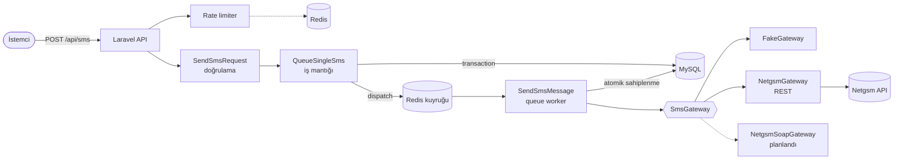
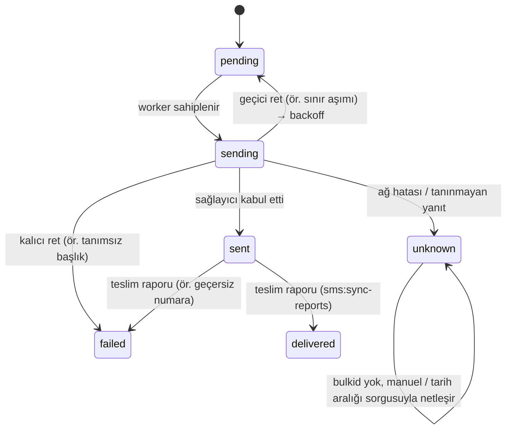

# SMS Gateway Demo

Laravel 12 ile yazılmış, Netgsm SMS API'si üzerinden SMS gönderen küçük ama üretim kalitesini hedefleyen bir demo uygulama.

Projenin amacı çok özellik göstermek değil; **SMS gibi geri alınamayan bir işlemi güvenilir şekilde yapmanın** zor kısımlarını göstermek: çift gönderimi önlemek, belirsiz durumları doğru ele almak, sağlayıcıyı soyutlamak ve bunların hepsini testlerle güvenceye almak.


## Özellikler

- **Kuyruk tabanlı SMS gönderim API'si** — istek doğrulanır, kuyruğa alınır ve `202 Accepted` döner.
- **İki katmanlı idempotency** — API seviyesinde `Idempotency-Key` + unique index, worker seviyesinde atomik sahiplenme.
- **Sağlayıcı soyutlaması** — `SmsGateway` arayüzü; `FakeGateway` (geliştirme/test) ve `NetgsmGateway` (resmi `netgsm/sms` paketi).
- **Akıllı retry** — geçici hatalar exponential backoff ile tekrar denenir; kalıcı hatalar ve belirsiz durumlar tekrar denenmez.
- **Rate limiting** — IP başına ve **numara başına** limit (SMS bombing'e karşı), Redis'te tutulur.
- **KVKK odaklı loglama** — telefon numaraları maskelenir, mesaj metni (OTP kodları dahil) hiçbir zaman loglanmaz.
- **Testler ve CI** — Pest ile unit/feature testler; GitHub Actions'ta Pint, Larastan ve vue-tsc.

## Mimari



### Mesaj durumları



## Tasarım kararları: neden böyle?

**Sağlayıcı bir arayüzün arkasında.** Uygulama Netgsm'i doğrudan tanımıyor; sadece `SmsGateway` sözleşmesini biliyor. Böylece proje hesap bilgisi olmadan `FakeGateway` ile çalışıyor, testler gerçek API'ye hiç dokunmuyor ve yeni bir sağlayıcı ya da protokol (SOAP) eklemek tek bir sınıf yazmak kadar kolay. Hangi gateway'in kullanılacağına `SMS_DRIVER` ile tek bir yerde (`AppServiceProvider`) karar veriliyor.

**Gateway'in üç sonucu var: kabul, ret, belirsiz.** Netgsm mesajı kabul ettiyse veya açıkça reddettiyse sonuç bellidir (`SendResult`). Ama istek gittikten sonra bağlantı koptuysa ya da yanıt anlaşılamadıysa SMS **gitmiş de olabilir**. Bu durum ayrı bir exception (`GatewayUnavailableException`) ile ifade ediliyor ve mesaj `unknown` olarak işaretleniyor; **tekrar denenmiyor**. Bir SMS'i geç göndermek, aynı SMS'i iki kez göndermekten daha iyidir. `unknown` mesajların sağlayıcı referansı (bulkid) olmadığı için teslim raporuyla doğrudan eşleştirilemiyor; tarih aralığı sorgusuyla telefon + zaman eşleştirmesi ya da operasyonel inceleme gerekiyor.

**Teslim raporu ayrı bir arayüz.** `sent`, sadece "Netgsm kabul etti" demek; telefona ulaşıp ulaşmadığı teslim raporundan öğreniliyor. Zamanlanmış `sms:sync-reports` komutu, 1 dakikadan eski ve 3 günden yeni `sent` mesajların raporlarını bulkid ile sorgulayıp `delivered` / `failed` yapıyor. Rapor sorgulama `SmsGateway`'e eklenmedi, ayrı bir `DeliveryReportProvider` arayüzü oldu (Interface Segregation): rapor desteği olmayan bir sağlayıcı boş metot yazmak zorunda kalmıyor. Güncellemeler `WHERE status = 'sent'` koşuluyla yapıldığı için komut iki kez çalışsa da sonuç değişmiyor.

**İdempotency iki katmanlı.**

1. _API:_ İstemci `Idempotency-Key` header'ı gönderir (Stripe'taki gibi). Anahtar numarayla birlikte hash'lenip unique index'li bir sütuna yazılır. Aynı anahtarla gelen ikinci istek yeni kayıt oluşturmaz, ilk sonucu döner (`Idempotent-Replayed: true`). Eşzamanlı isteklerde "önce kontrol et" yarış durumuna girebileceği için asıl güvence veritabanının unique kısıtı.
2. _Worker:_ Job, mesajı `UPDATE ... SET status='sending' WHERE id=? AND status='pending'` ile sahipleniyor. Kontrol ve değişiklik tek sorguda olduğu için aynı job iki kez çalışsa bile SMS bir kez gönderiliyor.

**Retry kararını hatayı en iyi tanıyan katman veriyor.** Netgsm'in yanıt kodları bir enum'a (`ResponseCode`) eşleniyor ve her kod için "tekrar denenebilir mi?" bilgisi orada tutuluyor. Geçici retler (sınır aşımı) 10/30/60/120 sn backoff ile tekrar deneniyor; kalıcı retler (tanımsız başlık, kimlik hatası) doğrudan `failed` oluyor.

**Numara başına rate limit.** IP limiti, farklı IP'lerden aynı kişiye yüzlerce SMS gönderilmesini engellemez. Numara başına limit hem kişiyi tacizden hem de hesabı maliyet saldırısından korur. Limitler Redis'te tutulduğu için yatay ölçeklemede de doğru çalışır.

**Türkçe encoding sadece gerektiğinde.** Netgsm'de Türkçe karakter desteği SMS başına karakter sayısını ve fiyatı etkiliyor. Encoding yalnızca metinde gerçekten Türkçe karakter varsa açılıyor.

**Loglarda kişisel veri yok.** Numaralar maskeli (`+90 532 *** ** 67`), mesaj metni hiç yazılmıyor çünkü OTP kodları da bu metinlerin içinde. Bu kural testlerle güvence altında. Exception mesajlarına bile numara eklenmiyor.

**Veri modeli.** Mesaj metni kampanyada bir kez saklanıyor, mesajlar kampanyaya referans veriyor (normalizasyon). `status` sütunu MySQL `ENUM` değil `string`. İzin verilen değerlerin tek kaynağı PHP enum'ı (`MessageStatus`); veritabanında ikinci bir liste tutulmuyor. Böylece yeni bir durum eklemek migration gerektirmiyor ve şema SQLite (testler) ile MySQL arasında aynı davranıyor. Bedeli: veritabanı seviyesinde değer kontrolü yok; tüm yazmalar Eloquent'in enum cast'i üzerinden yapılıyor. Index'ler gerçek sorgulara göre tasarlandı (`(sms_campaign_id, status)`, `(status, updated_at)`), composite index'lerde leftmost-prefix kuralı dikkate alındı.

**Value object ve DTO'lar.** `PhoneNumber`'ın constructor'ı private; tek giriş yolu doğrulayan `from()`. Geçersiz bir numara uygulamada nesne olarak var olamıyor. Sağlayıcının dizi tabanlı yanıtları gateway'in içinde kalıyor, dışarıya tipli `SendResult` olarak çıkıyor.

**Yönetim paneli için Inertia + Vue 3 + TypeScript.** Ayrı bir SPA ve REST API yerine Inertia; auth, validation ve routing tek yerde kalıyor. Dışarıya açık SMS API'si ise `routes/api.php`'de ayrı.

## Kurulum

Gereksinimler: PHP 8.3+, Composer, Node.js 22+, Docker.

```bash
git clone <repo-url> sms-gateway-demo && cd sms-gateway-demo

cp .env.example .env
composer install
npm install
php artisan key:generate

docker compose up -d          # MySQL 8.4 + Redis 7
php artisan migrate

composer run dev              # web sunucusu + queue worker + loglar + Vite
php artisan schedule:work     # (ayrı terminalde) teslim raporu senkronizasyonu
```

Varsayılan driver `fake`'tir; SMS gerçekten gönderilmez, `storage/logs/sms-*.log` dosyasına (maskeli olarak) yazılır. Netgsm ile denemek için `.env` içinde `SMS_DRIVER=netgsm` yapıp `NETGSM_USERCODE`, `NETGSM_PASSWORD`, `NETGSM_HEADER` değerlerini girin.

## API

**SMS gönder**

```bash
curl -i -X POST http://127.0.0.1:8000/api/sms \
  -H 'Accept: application/json' \
  -H 'Content-Type: application/json' \
  -H 'Idempotency-Key: siparis-1042' \
  -d '{"phone":"0532 123 45 67","message":"Siparişiniz kargoya verildi."}'
```

```http
HTTP/1.1 202 Accepted
Idempotent-Replayed: false

{ "data": { "id": 1, "status": "pending", "status_label": "Kuyrukta", "phone": "+90 532 *** ** 67", ... } }
```

Aynı istek aynı `Idempotency-Key` ile tekrar gönderilirse yeni mesaj oluşmaz; aynı yanıt `Idempotent-Replayed: true` ile döner.

**Durum sorgula**

```bash
curl http://127.0.0.1:8000/api/sms/1 -H 'Accept: application/json'
```

| Durum | Anlamı                                                  |
| ----- | ------------------------------------------------------- |
| `422` | Geçersiz numara / metin                                 |
| `429` | Rate limit aşıldı (IP başına 30/dk, numara başına 3/dk) |

## Testler ve kalite

```bash
php artisan test                  # Pest: unit + feature
vendor/bin/pint --test            # kod stili
vendor/bin/phpstan analyse        # Larastan (level 5)
npm run typecheck                 # vue-tsc
```

Öne çıkan testler:

- _Aynı job iki kez çalışsa bile SMS bir kez gönderilir._
- _Aynı Idempotency-Key ile gelen ikinci istek yeni mesaj oluşturmaz._
- _Belirsiz durumda tekrar denemez, `unknown` olarak işaretler._
- _Loglara açık numara ve mesaj metni yazılmaz._
- Netgsm yanıt kodlarının (başarı, kalıcı/geçici ret, tanınmayan yanıt, ağ hatası) doğru sonuca çevrilmesi.

Testler her zaman `SMS_DRIVER=fake` ile çalışır; test çalıştırmak yanlışlıkla gerçek SMS gönderemez.

## Proje yapısı

```
app/
├── Actions/Sms/QueueSingleSms.php        # iş mantığı: kayıt + kuyruğa alma
├── Http/
│   ├── Controllers/Api/SmsController.php
│   ├── Requests/SendSmsRequest.php       # doğrulama
│   └── Resources/SmsMessageResource.php  # API yanıt biçimi
├── Jobs/SendSmsMessage.php               # worker: sahiplenme, gönderim, retry
├── Models/{SmsCampaign,SmsMessage}.php
└── Sms/
    ├── Contracts/SmsGateway.php          # sağlayıcı sözleşmesi
    ├── Data/                             # PhoneNumber, OutgoingSms, SendResult
    ├── Enums/                            # MessageStatus, CampaignType
    ├── Exceptions/GatewayUnavailableException.php
    └── Gateways/
        ├── FakeGateway.php
        └── Netgsm/{NetgsmGateway,ResponseCode}.php
```

## Bilinen sınırlar ve yol haritası

- [ ] **Toplu gönderim** — numaraları chunk'lara bölüp `Bus::batch` ile kuyruklama, kampanya ilerlemesi.
- [ ] **Netgsm SOAP/XML gateway** — aynı arayüzün ikinci protokol implementasyonu.
- [x] **Teslim raporu (pull)** — `sms:sync-reports` ile periyodik sorgulama.
- [ ] **Teslim raporu (push)** — Netgsm'in rapor bildirimlerini alan webhook endpoint'i (sorgulama trafiğini azaltır).
- [ ] **`unknown` mesajların netleştirilmesi** — tarih aralığı sorgusuyla telefon + zaman eşleştirmesi; uzun süre `sending`'de kalan mesajları toplayan temizlik görevi.
- [ ] **İstemciye durum bildirimi (webhook)** — şu an istemci durumu `GET /api/sms/{id}` ile sorguluyor (polling). `callback_url` ile HMAC imzalı, kuyruk üzerinden ve retry'lı bildirim gönderilmeli.
- [ ] **Bakiye ve başlık listesi** — Redis cache ile.
- [ ] **OTP akışı** — hash'lenmiş kod, süre ve deneme limiti.
- [ ] **API kimlik doğrulaması** — şu an API anonim; API anahtarı veya Sanctum token.
- [ ] **Uygulamanın Docker imajı** — şu an Docker sadece MySQL ve Redis için.
- [ ] **Netgsm hata kodları** — `00`, `30`, `40` resmi paketin dokümanında yer alıyor; diğerleri (20, 50, 51, 70, 80, 85) gerçek bir hesapla doğrulanmalı.
- [ ] **phpredis** — demo kurulum kolaylığı için Predis kullanıyor; üretimde phpredis eklentisi tercih edilmeli.
- [ ] Testler hız için SQLite (bellek içi) ile çalışıyor; CI'da MySQL'e karşı da çalıştırılabilir.

## Teknolojiler

Laravel 12 · PHP 8.3 · MySQL 8.4 · Redis 7 · Pest · Larastan · Inertia v3 · Vue 3 · TypeScript · Tailwind CSS 4 · Docker Compose · GitHub Actions
